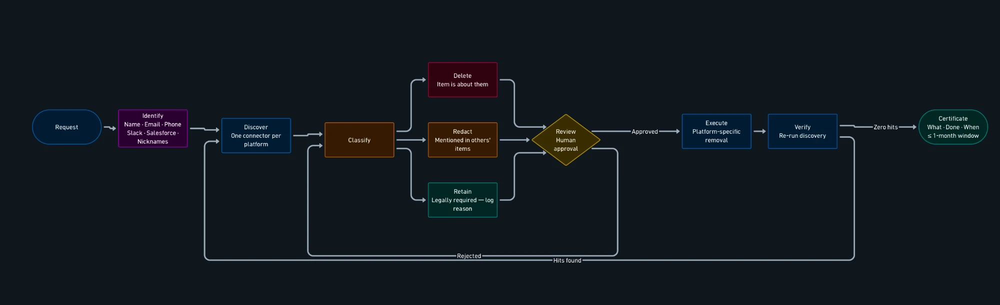
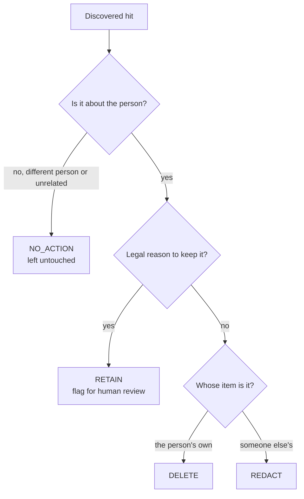
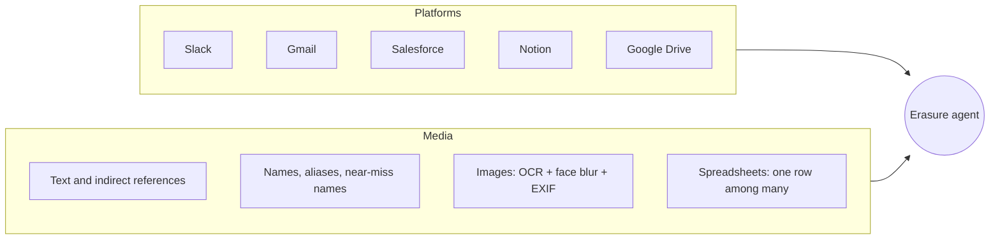
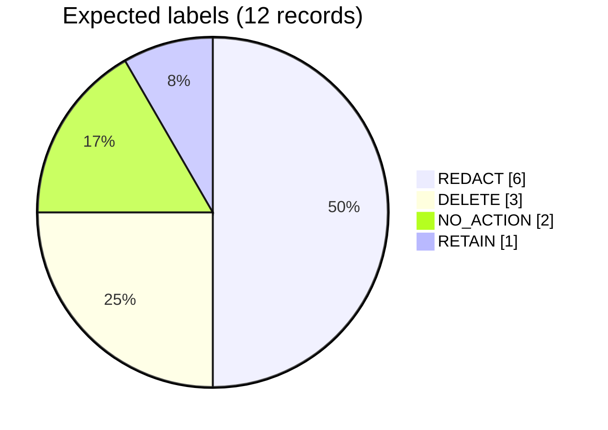
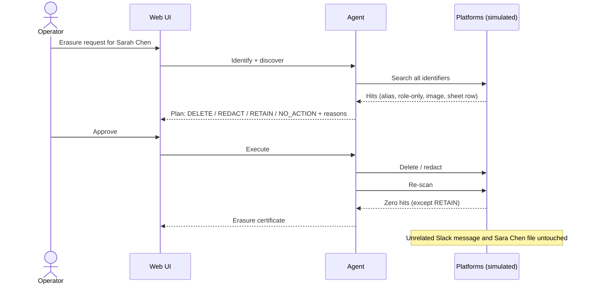

# Right-to-Erasure Agent

An agent that handles a GDPR **right to erasure** request (Article 17): given one person, it finds their personal data across a company's internal platforms, removes or redacts it after human approval, and produces an audit certificate as proof.

> Hackathon project. Not legal advice. Verify specific GDPR obligations and exceptions against a primary source.

**Why:** companies generally have one month to answer an erasure request, but nobody knows everywhere a person's data lives. It is scattered across platforms, file formats and name variants.

## Pipeline



Rejected plans loop back to Classify. If Verify still finds hits, the agent loops back to Discover. The certificate records what was done and when, within the one-month response window.

| Step | What happens |
|---|---|
| Identify | Expand the person into every identifier: name variants, aliases, emails, phone, Slack handle, CRM ID |
| Discover | Search each platform for those identifiers |
| Classify | Label each hit `DELETE`, `REDACT`, `RETAIN` or `NO_ACTION`, with a reason |
| Review | A human approves the plan. Nothing destructive happens before this |
| Execute | Platform-specific deletion or redaction |
| Verify | Re-run discovery; expect zero hits except approved `RETAIN` items |
| Certificate | Audit log of what was found, the action, the reason and timestamps |

## Classification labels



## Scope



Platforms are **simulated** with synthetic data. Real API connectors are a stretch goal. Never run real deletions on real accounts.

## Synthetic dataset

The demo subject is **Sarah Chen** (alias **Sally**). The seed script writes 12 records across the five platforms, plus ground-truth labels used as test assertions.

| Platform | Record | Expected label |
|---|---|---|
| Slack | Message naming Sarah Chen | REDACT (open: DELETE if her own message) |
| Slack | Message using alias "Sally" | REDACT |
| Slack | Unrelated lunch message | NO_ACTION |
| Gmail | Thread she sent | DELETE |
| Gmail | Her name and email in others' thread | REDACT |
| Salesforce | Her contact record | DELETE |
| Salesforce | Call note mentioning her | REDACT (open: or DELETE) |
| Salesforce | Invoice billed to her | RETAIN, human review |
| Notion | Meeting notes, "our Berlin partnerships lead" | REDACT |
| Drive | Summit badge image (name and face) | REDACT (mask) |
| Drive | Attendee spreadsheet | DELETE her row only |
| Drive | "Sara Chen" badge image (different person) | NO_ACTION |



Two of the six REDACT labels (Slack full-name mention, Salesforce note) are still open team decisions between REDACT and DELETE.

## Demo flow



## Getting started

```bash
python3 -m venv .venv && source .venv/bin/activate
pip install -r requirements.txt
python -m pytest -q                      # seed data + API flow tests

cd frontend && npm install && npm run build && cd ..
uvicorn erasure.api:app --port 8000      # serves the API and the built UI at http://localhost:8000
```

Frontend development with hot reload: run the backend as above, then `cd frontend && npm run dev` (Vite on :5173 proxies `/api` to :8000).

`python -m erasure.seed` regenerates `sim_data/` on demand. The API makes a throwaway working copy of it, so **Reset demo** in the UI restores everything.

## API

| Endpoint | Purpose |
|---|---|
| `GET /api/state` | Full workspace state: requests, records, matches, decisions, execution, verification, audit |
| `POST /api/requests` | Create a request and run discovery |
| `POST /api/requests/{id}/select`, `POST /api/scan` | Switch request, re-run discovery |
| `PUT /api/decisions` | Record a reviewer decision (approve / change / reject with justification) |
| `POST /api/execute` | Run only approved DELETE / REDACT / RETAIN actions |
| `POST /api/verify` | Re-scan; reports deleted, redacted, retained, unresolved, reappeared |
| `GET /api/certificate` | Erasure certificate: findings, decisions, actions, timestamps, limitations |
| `POST /api/crm-sync` | Demo only: a stale sync re-creates an erased record so Verify can catch it |
| `POST /api/reset` | Restore the seed data |

## Repository layout

```
erasure/
  models.py    labels, platforms, subject, record, expectation
  subject.py   the synthetic subject (Sarah Chen) and the decoy name
  seed.py      builds the simulated platforms and ground truth
  engine.py    identify/discover/classify, execute, verify, certificate
  api.py       FastAPI app (also serves frontend/dist)
frontend/      EraseFlow React + Vite UI (talks to /api)
docs/
  pipeline.webp  pipeline diagram used in this README
tests/         seed-data and API flow tests
```

## Behaviour worth knowing

- Alias-only matches (for example "Sally") are never treated as proof of identity; they stay `MANUAL REVIEW` until a reviewer decides.
- Role-only references ("our Berlin partnerships lead") are found via the request's role references and marked as indirect, lower-confidence matches.
- `RETAIN` needs a written justification; the invoice stays unresolved until one is given.
- Image redaction blacks out the name and face regions and re-saves without EXIF. Spreadsheet deletion removes only the requester's row.
- Discovery is exact-string and rule-based; there is no real OCR or face detection yet (the seed data carries the OCR text).

## Status

- [x] Models, synthetic dataset, ground-truth labels, tests
- [x] Pipeline: identify, discover, classify, review, execute, verify, certificate
- [x] FastAPI backend
- [x] EraseFlow UI connected to the backend
- [ ] Real OCR and face detection for images
- [ ] Optional: live platform connectors

## Open decisions

- Redaction style: `[REDACTED]`, a pseudonym, or full removal
- What counts as "deleted": trash, recycle bins, version history, backups. Be honest about what is not handled
- Retention rules: a short explicit list (financial records, contracts)
- Which platforms, if any, get real API integration
